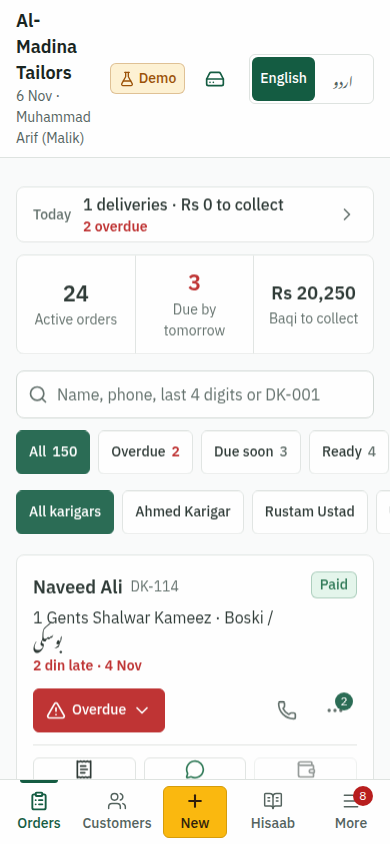
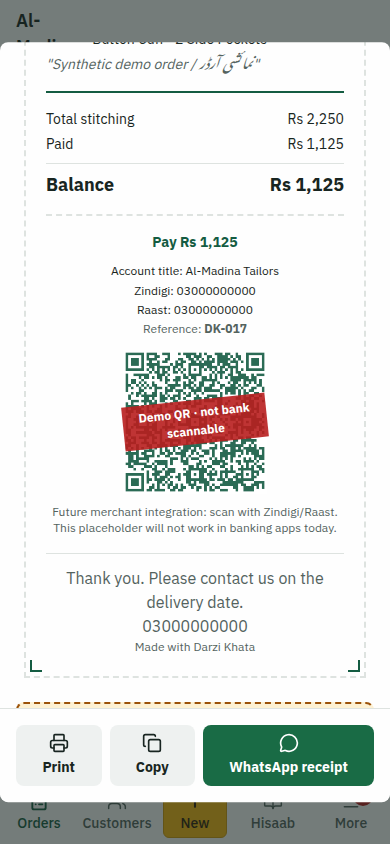
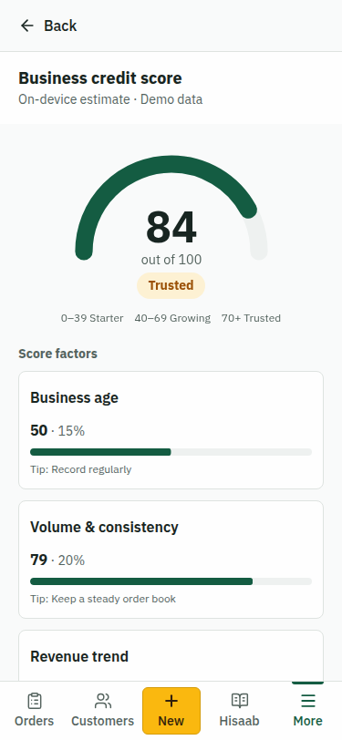
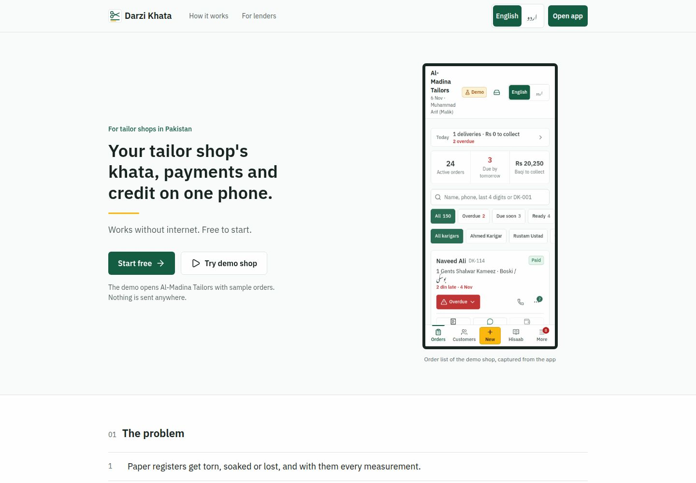

# Darzi Khata — درزی کھاتہ

**Live:** https://darzi-khata.replit.app

**Demo owner:** `demo@darzikhata.com` / `demo1234`

Demo records and payments are synthetic; no real money is moved.

| Orders | Parchi | Credit profile |
|---|---|---|
|  |  |  |

### 60-second demo
1. Open the live link → **Try demo shop**. Skip onboarding once.
2. **More → 60-second pitch demo → Reset demo and begin**.
3. Follow **Next** to add an order and inspect the real parchi/WhatsApp draft.
4. Simulate its Zindigi collection; baqi becomes zero. No bank is contacted.
5. Continue to the actual credit profile and its before/after score.

**Team:** GIKI × Zindigi Prize project context. Public team-member names are
awaiting confirmation; no names have been invented.

### Release checks
The More-page version contains the source commit SHA and build timestamp.
GitHub pushes do **not** republish the live site. After clicking Publish in
Replit, check `/`, `/app`, the screenshots and the More version in a fresh
browser, then check an already-installed PWA. Update notifications never erase
localStorage or fabric photos, and do not force-reload an unfinished form.

## Local accounts

Darzi Khata accounts are device-only: registration and sign-in work offline on
this browser, not through a server identity service. A different device needs an
explicit backup transfer. Keep a protected backup before clearing browser data.
New passwords use Web Crypto PBKDF2-SHA-256 with a random salt and 210,000
iterations. Older unsalted password hashes remain readable and are upgraded
only after a successful password check. Passwords are never saved as plaintext.
The optional PIN is a local privacy lock, not encryption of the shop register.

## Product overview

An offline-first, bilingual Pakistani tailor-shop khata with order management,
payment records and an illustrative business credit profile. Built for the
financial-inclusion pitch at GIKI × Zindigi Prize.

## Live demo

**Published URL:** https://darzi-khata.replit.app

This is the verified existing deployment URL. Workspace changes require
**Publish / Republish** before appearing at that URL.

## Landing page and routes

The public home page is `/`. Shop work is under `/app`, with account entry at
`/app/login`. Start free opens `/app/login?mode=signup`; Try demo shop opens
the isolated demo account. Existing account/register storage keys are unchanged.
Installed PWAs use `/app` as their start URL, and opening `/` in standalone mode
redirects there before painting the landing page.




The landing page has real Playwright captures in both languages, demo-derived
impact counters, the GIKI context, the repository link and a 1200×630 social image
made from the actual order list. The SBP 92% figure is linked to its original Q2
FY26 report and correctly refers to transaction volume through banks and EMIs,
not every cash purchase in Pakistan. Team names and a public WhatsApp contact
must be supplied by the team; no names or phone numbers have been invented.

## Pitch and shop tools

- **60-second pitch:** More → 60-second pitch demo → Reset demo and begin.
  This resets only the financial-demo namespace, not the real shop. Follow Next:
  record an order, inspect its real parchi/WhatsApp draft, simulate a Zindigi
  collection, see baqi reach zero, and animate the resulting credit score.
  The score comes from the same model as the credit page, not a hard-coded
  before/after figure. Demo records and QR payments are clearly synthetic.
- **Lender link:** More → Share lender profile. Explicit consent creates a
  signed seven-day read-only snapshot under `/lender/:token`, with revenue
  chart, operating measures, score factors, profit and a print-to-PDF action.
  It includes no customer contacts, measurements, photos or account credentials.
  The link is self-signed by an ephemeral key: this protects integrity, **not**
  verified business identity. It is not a bank/bureau credit report. Anyone with
  the link can read it; offline links cannot be revoked before expiry.
- **Baqi recovery:** customer-ID groups sorted by amount then age; recovered this
  month counts payments made after the order's calendar date. The reminder link
  opens a consented parchi snapshot containing payment details and an illustrative
  QR. WhatsApp requires a separate Send action; nothing is sent automatically.
- **Eid/season planner:** enter the confirmed local deadline, available workers
  and suits per worker/day. See remaining suits, capacity, shortfall, allocation
  by karigar and a suggested new-order cut-off date. It assumes working every day;
  adjust for leave, weekends and garment complexity.
- **Expenses/profit:** record thread, buttons, lining, wages, rent and other
  costs. Hisaab shows this month's received income minus recorded expenses.
  With expense records, the score allocates 10% to observed profit margin and
  reduces revenue-trend weight from 20% to 10%; legacy shops retain old scoring.
- **Customer status:** expand Customer tracking link on a parchi to share a
  seven-day `/track/:token` status snapshot without login. It deliberately omits
  customer contacts and measurements. **This is not a live server-synchronised
  feed**: send a new snapshot when the status changes.
- **Savings/committee:** set a target and suggested percentage of digital
  receipts, then record dated contributions. No money is transferred, held or
  automatically sent to a wallet.
- **Women home-tailor mode:** choose the business type in Settings for a simpler
  home screen and ladies' garments first in both order forms. The shop-phone
  privacy setting removes the shop phone from shared parchi text. Lender
  snapshots carry a home-based badge.

Expense records, planner preferences, savings contributions and privacy choices
live in the existing per-shop settings record and travel with plain/encrypted
backups. Imports validate them before touching saved records.

## Verification commands

```sh
pnpm typecheck
pnpm test
E2E_PRODUCTION=1 pnpm exec playwright test
cd artifacts/darzi-khata && npx impeccable detect src/
# Local production build outside the managed workflow:
PORT=24310 BASE_PATH=/ pnpm --filter @workspace/darzi-khata build
```

`design-lint.test.ts` covers the section-B regressions, including UI primitives.
The source-only Impeccable command cannot assess rendered contrast or element
size; see `QA.md` for actual mobile browser and Lighthouse evidence.

On the login screen, expand **Demo Accounts**. All four accounts use `demo1234`:

| Role | Email |
|---|---|
| Shop owner | `demo@darzikhata.com` |
| Ustad Bashir | `bashir@darzikhata.com` |
| Ahmed Karigar | `ahmed@darzikhata.com` |
| Rustam Ustad | `rustam@darzikhata.com` |

The owner demo starts with **150 synthetic orders over six calendar months**,
growing revenue, cash/wallet/Raast/bank records, delivered and unfinished work,
assigned karigars, and example order conversations. These are synthetic records,
not customers or verified financial transactions. Do not send messages to demo numbers.

## New financial-inclusion features

- **Payment details:** account title, Zindigi wallet and Raast ID/IBAN in Settings,
  shown on the parchi and included in WhatsApp receipt/reminder text.
- **Demo QR:** generated locally with `qrcode`, encoding shop, account, PKR
  balance and order reference. **Not a bank-compatible Raast/EMV merchant QR.**
  The payload builder is isolated in `src/lib/payments.ts` for a future authorized
  merchant API integration. Banking apps cannot process this placeholder.
- **Payment ledger:** incremental amount, cash/Zindigi/Raast/bank method and date.
  Existing advances migrate once into cash entries. Simulated Zindigi settlement
  is restricted to the isolated demo dataset; it never contacts a bank.
- **Digital vs cash:** this month's amount-weighted digital share on the dashboard,
  plus six-month payment-date charts and tables in Impact.
- **Darzi Credit Score:** an explainable, local, 0–100 illustration. Factors:
  business age (15%), order volume/consistency (20%), revenue trend (20%),
  observed on-time delivery (20%), collections (15%), digital payments (10%).
  Starter <40, Growing 40–69, Trusted ≥70.
- **Indicative loan estimate:** 1.5 × average monthly billed revenue × score/100,
  capped at PKR 300,000. Requires at least five orders over two calendar months.
  **Not a loan offer, lender decision, or credit-bureau rating.**
- **Consent-first business profile:** “Apply via Zindigi” creates a local printable
  A4 summary only after consent. It sends nothing. Includes shop name/type,
  months active, revenue series, order count, delivery/collection percentages
  and score. No customer names, phone numbers or measurements.
- **WhatsApp reminders:** ready for collection, balance and tomorrow's delivery;
  pending list for ready orders >3 days and delivered orders with unpaid balances.
  Pakistani numbers normalized to `923...`. Opens a draft, never sends automatically.
  `wa.me` is text-only; QR images are on the receipt, not attached automatically.
- **Voice measurements:** Web Speech API, Urdu (`ur-PK`) with an English language
  fallback. Parses Urdu/Roman Urdu numbers 1–60, English and half inches. Transcript
  and proposed measurements are shown before Apply. Hidden when unsupported.
  Recognition depends on the browser and usually needs internet.
- **Impact:** recorded orders/revenue, collections, digital share, customers,
  karigars and observed on-time deliveries.
- **Business types:** shop, home-based and women home-tailor.
- **First-run intro:** three bilingual slides, record → payments → credit record.

## Existing shop features preserved

- Create, edit and delete orders; per-shop DK serials; urgent flag; suit count;
  delivery dates; pending → stitching → ready → delivered.
- Eleven kameez/shalwar measurements, half-inch steppers, saved templates,
  style details and customer-history measurement copying.
- Shop-owner and karigar views, assignment, per-order conversations, team
  management and shareable invitation instructions.
- Customer directory/history, filters, overdue and due-today views, earnings,
  printable worksheets, parchi/WhatsApp receipt, dark mode, JSON backup/restore.
- Local email/password accounts remain; an optional hashed PIN can lock the local
  session without replacing account login.

## Offline tailor-workflow upgrade

- Bottom navigation: Orders, New, Customers, Payments and More. Full four-step
  entry remains, with a Quick Order shortcut using saved customer measurements.
- Saved customers have stable IDs, notes and garment-specific measurement
  profiles. Search matches names, formatted numbers and the last four digits.
- Mixed-garment orders: gents shalwar kameez, ladies kameez, ladies trousers,
  waistcoats, pant-shirt and kids. Each line has independent measurements,
  quantity, price and notes. Totals derive from those lines.
- Fabric/design photo capture and upload: compressed below 200,000 bytes and
  stored in IndexedDB, never as localStorage base64. Photos appear on cards and
  receipts and are included in JSON backups.
- Urdu-first RTL or English-first labels, normal/large text, status icons,
  daily delivery/collection summary, delete confirmation and undo.
- Optional 4–8 digit PIN uses a random salt plus SHA-256; five wrong attempts
  lock for 30 seconds. Owned legacy plaintext PINs migrate without changing the
  PIN. The PIN is not data encryption or a replacement for secure cloud login.
- Versioned, idempotent migrations preserve old orders and link customers by
  normalized phone. Restore validates first, imports photos into the current
  namespace, restores templates/manual karigars and repairs the DK counter.
  LocalStorage batches roll back if a quota/write error occurs.

## Offline and data safety

### Optional local backup reminders

Turn on **Settings → Data backup → Remind me to back up** to see an
English/Urdu reminder in the selected language when the register has changed.
It is off by default. Dismissing it hides it until the next register change;
turning the setting off disables reminders entirely.

After either plain or encrypted export, check that the file exists and choose
**I saved the file**. Browsers cannot reliably confirm that a download was saved,
so starting a download alone never updates the last confirmed backup date.
Choose **Not saved / cancelled** if it did not finish. Failed or interrupted
exports do not count. Changes made during an export still need a fresh backup.

Reminder preferences and the last confirmed export date stay on this device,
separately for each shop and the financial demo. No passphrase, exported register
snapshot, backup file, cloud upload, or external notification is stored/sent by
the reminder. Clearing browser data removes this reminder history too.

### Optional passphrase-protected backups

In **Settings → Data backup**, **Export backup** still downloads the original
plain JSON format. Anyone who has that file can read it. The separate
**Export encrypted backup** action asks for a unique passphrase (at least 12
characters) and confirmation. Use something different from your account
password or PIN, and keep it safe: there is no passphrase reset or recovery.

Encryption runs locally using Web Crypto: AES-256-GCM with a random 12-byte IV,
a 128-bit authentication tag, and a key derived by PBKDF2-SHA-256 with 600,000
iterations and a fresh 16-byte salt. Versioned envelope metadata is authenticated.
The encrypted file is named `darzi-khata-encrypted-backup-YYYY-MM-DD.json`.
Current browsers over HTTPS (or a trusted localhost context) are required;
unsupported browsers fail explicitly without downloading a plaintext substitute.

**Restore data** accepts both formats. An encrypted file first asks for its
passphrase, then validates the decrypted data and shows the same replacement
confirmation as plain JSON. A wrong passphrase or damaged file leaves the
current register unchanged. Old plain JSON backups still use the existing
migration and restore path. Both exports exclude passwords and PIN hashes.
The passphrase is held only in memory, never stored by the app or uploaded.
Only the downloaded file is encrypted: existing files and local browser data
are not rewritten or encrypted.

**No backend or cloud sync.** Accounts and business records live in this browser's
`localStorage`; fabric photos use IndexedDB and the session uses `sessionStorage`. Accounts are a local access
convenience, not secure server-enforced authentication. Hashing alone does not
make localStorage accounts production-grade identity management.

Owner and karigar accounts can demonstrate shared tasks on the **same browser**.
Invitations do not create cross-device team sync. Clearing browser storage loses
the khata: export a backup regularly. Publishing does not upload local records.

Demo mode isolates orders, customers, photos, serials, payment settings, templates and karigar lists
in separate keys; switching off returns to original records. Clear Demo removes
only that demonstration area. Team account membership itself remains local to
the shared accounts list.

| Key family | Purpose |
|---|---|
| `darzi-khata-accounts` | Local user accounts |
| `darzi-khata-orders-{ownerId}` | Original shop orders |
| `darzi-khata-settings-{ownerId}` | Original shop settings |
| `darzi-khata-templates-{ownerId}` | Measurement templates |
| `darzi-khata-karigars-{ownerId}` | Karigar name list |
| `darzi-khata-serial-{ownerId}` | Original serial counter |
| `darzi-khata-customers-{ownerId}` | Saved customers and measurement profiles |
| `darzi-khata-schema-{ownerId}` | Additive storage schema version |
| `darzi-khata-lock-{userId}` | Optional salted PIN hash and lockout state |
| `darzi-khata-demo-mode-{ownerId}` | Active data-area selection |
| `darzi-khata-*-financial-demo-{ownerId}` | Isolated demonstration records |

Old unscoped keys are preserved. The first non-demo shop claims a copy of the
pre-account orders/settings/templates/karigars/counter once; originals remain
available for recovery, except legacy plaintext PINs are removed after successful
owned-PIN migration. Old order advances become cash ledger entries without
changing the collected total. Legacy delivered orders without `deliveredAt`
are excluded from the observed on-time denominator rather than assumed on-time.

Revenue means **billed order value**, collections mean amounts recorded received.
Digital share is amount-weighted from payment records. The score uses at most
the latest six calendar months for volume/revenue trends; age uses the first
recorded order. All results are self-reported and illustrative.

## PWA

Production builds generate a manifest, real 192/512px icons and a Workbox
service worker. The app shell, JS, CSS, icons and bundled Urdu Nastaliq font are precached. Install through
your browser's Install/Add to Home Screen after one successful online visit.
App data entry works offline; WhatsApp and browser-hosted speech recognition
do not. The Urdu font is local; online Inter font requests have system-font fallbacks.
The service worker is disabled during Vite development.

## Develop and verify

Requires Node 24 and pnpm. The current workspace catalogs React 19 and Vite 7;
no framework downgrade was made to match the older brief.

```bash
pnpm install
# Replit's existing artifact workflow supplies PORT and BASE_PATH:
pnpm --filter @workspace/darzi-khata run dev
# Outside managed workflows:
PORT=24310 BASE_PATH=/ pnpm --filter @workspace/darzi-khata run dev

pnpm --filter @workspace/darzi-khata test # Node financial tests + Vitest offline suites
pnpm --filter @workspace/darzi-khata typecheck
PORT=24310 BASE_PATH=/ pnpm --filter @workspace/darzi-khata build
```

The tests cover migration, incremental/invalid payments, QR disclaimers,
payment-date digital share, score/empty/legacy-delivery cases, phone/reminder
logic, all canonical Urdu/Roman Urdu numbers 1–60 and voice parsing.

## Publishing

Live production URL: not yet published for this Replit project. The development
preview is not a production URL. Use Publish to release, then record the verified
production URL here.

The existing artifact already serves a static Vite build from
`artifacts/darzi-khata/dist/public`, with SPA rewrites. The monorepo also contains
an unused API artifact; the khata does not call it. Keep managed artifact routing.
Use Replit's Publish/Republish action to release these workspace changes.

## Mobile acceptance checks

From the workspace root:

```bash
pnpm --filter @workspace/darzi-khata typecheck
pnpm --filter @workspace/darzi-khata test
pnpm test:e2e
pnpm audit:design
```

Playwright uses a separate, isolated browser context for every test, a 390×844
touch viewport, and Asia/Karachi time. The layout test also checks 360px width.
Set `E2E_BASE_URL` to test another preview and `CHROME_PATH` if Chromium is not at
`/repl/tools/bin/chromium`. Run the offline test against a production static
build with `E2E_PRODUCTION=1`; Vite development does not register a service worker.
Reports and screenshots are written to ignored `generated-artifacts/`.

See `DESIGN.md` for the visual rules and `QA.md` for measured results and any
remaining limitations. A sample payment QR is **not** a bank-scannable Raast or
Zindigi merchant QR.

## Main implementation files

- `src/lib/payments.ts`: ledger migration, validation, demo QR builder and shares.
- `src/lib/credit-score.ts`: pure scoring and business summary functions.
- `src/lib/voice-parse.ts`: pure speech-to-measurements parser.
- `src/lib/reminders.ts`: bilingual templates and phone normalization.
- `src/lib/demo-data.ts`: deterministic six-month synthetic dataset.
- `src/hooks/use-demo-mode.ts`: data-area switching and demo-only clearing.
- `src/lib/local-store.ts`: cross-component/tab updates and legacy data claim.
- `src/components/credit-modal.tsx`: consent and printable A4 profile.
- `vite.config.ts`: production PWA precaching.

## Screenshot placeholders

- [ ] Dashboard: current-month payment mix and demo badge
- [ ] Parchi: demo QR and account details
- [ ] Credit: six factors and indicative estimate
- [ ] A4 business profile
- [ ] Impact: six-month cash/digital chart
- [ ] Voice transcript preview on Chrome Android
